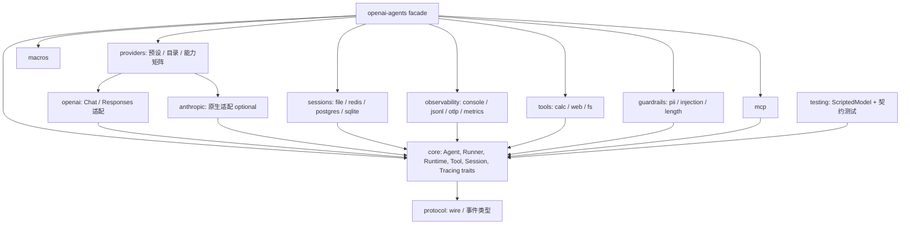
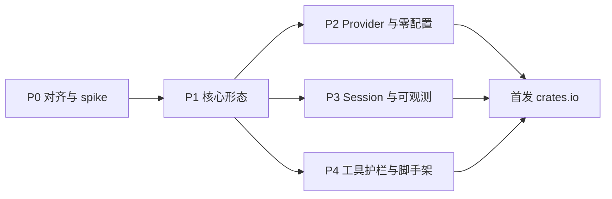

# 改进报告:低学习成本 + 开箱即用扩展(2026-10-16)

前置阅读:[`ANALYSIS-2026-10.md`](./ANALYSIS-2026-10.md)(问题诊断)、[`REPORT-2026-10-16.md`](./REPORT-2026-10-16.md)(事实复核与初版建议)。本报告不重复诊断,只回答一个问题:**怎样在结构合理的前提下,把用户的学习与使用成本降到最低,并提供开箱即用的扩展。**

## 0. 前提与结论

**已确认的前提**

- API 破坏不设限,以最优结构为准。
- 定位:**行为对齐 Python,API 按 Rust 习惯设计。** 保留 `vendor/` pin 与 `conformance/` parity,放弃 API 形态对齐。
- 扩展覆盖四类:Provider 预设、Session 与 RunState 存储、Tracing 与可观测、内置工具与护栏。

**一句话结论**

当前的成本主要来自三处:**(1) 概念太多且要一次学完**(`RunOptions`/`RunConfig`/`ModelSettings` 三层、`FunctionTool` 两套写法、`needs_*` 两套术语);**(2) 出了示例就没有现成零件**(换 provider、持久化、导出 trace、加常用工具都要自己写);**(3) 隐式全局状态与类型擦除让错误晚暴露**。

解决思路是三层渐进披露,每一层只增加一个概念:

| 层 | 用户要学的 | 目标 |
| --- | --- | --- |
| L0 一行跑通 | `Agent` + 环境变量 | 无 key 可离线跑;有 key 设一个变量即可 |
| L1 具名组合 | `Capability`(工具/指令/护栏打包)、预设 provider、预设 store | 常见需求"点名即用",不必碰字段 |
| L2 trait 扩展 | `Tool`、`Model`、`Session`、`TracingProcessor`、`Guardrail`、中间件 | 自定义实现,与内置实现同一契约 |

**三个高杠杆动作**:(a) 核心形态一次到位(`non_exhaustive` + builder、`Tool` trait、显式 `Runtime`、去全局),(b) 把四类扩展做成独立 crate 并给出统一契约测试,(c) 脚手架 + 零配置首跑。

---

## 1. 现状证据(2026-10-16 已核实)

只列与本报告决策直接相关的事实。路径均相对仓库根。

| # | 事实 | 证据 |
| --- | --- | --- |
| F1 | 进程级全局 9 处:`DEFAULT_PROVIDER_FACTORY` / `DEFAULT_MODEL_PROVIDER` / `MISSING_PROVIDER`、`TRACING_DISABLED`、trace processor 槽、`WRAPPERS`(handoff 历史标记)、`DEFAULT_OPENAI_API`、facade 的 `Once`、`run_blocking` 的全局 tokio runtime | `core/src/run/resolve.rs:42-44`、`core/src/tracing/mod.rs:24`、`core/src/tracing/processor.rs:7`、`core/src/handoffs/history.rs:31`、`openai/src/default_api.rs:20`、`facade/src/runner.rs:87`、`core/src/run/mod.rs:234` |
| F2 | `Arc::new(agent.clone())` 共 11 处;另有每个工具调用各克隆一次 `agent` | `run/agent_loop.rs:318,370,463,746`、`run/finalize.rs:56,92`、`run/tools/execute.rs:72,88`、`run/config.rs:101`、`run/errors.rs:208`、`agent.rs:250`、`tool.rs:203` |
| F3 | 带 `Agent` 的回调:`RunHooks`/`AgentHooks` 全部方法(`&Agent`);`InputGuardrailFn`/`OutputGuardrailFn`/`IsEnabledFn`/动态 instructions(`Arc<Agent>`);`McpServer::list_tools`(`&Agent`);`ToolInputGuardrailData.agent` | `core/src/lifecycle.rs`、`guardrail.rs:19-38`、`tool.rs:159-165`、`agent.rs:49-51`、`mcp/server.rs:31-35`、`tool_guardrails.rs:28,37` |
| F4 | `Handoff.agent` **已经是 `Arc<Agent>`** | `core/src/handoffs/mod.rs:72` |
| F5 | `ToolResult.interruptions` / `nested_state` 只被 run 内部读取,普通工具作者用不到 | `run/tools/execute.rs:168,220-224`、`run/as_tool.rs:86` |
| F6 | `ModelProvider::get_model` 是**同步**方法 | `core/src/model/provider.rs:13-16` |
| F7 | `MultiProvider` 按 `split_once('/')` 路由,无前缀时走 `openai` | `model/provider.rs:65-69,38` |
| F8 | `TracingProcessor` 为同步回调;全局注册函数 `set_trace_processors` / `add_trace_processor` / `flush_traces` | `tracing/processor.rs:41-52,14,20,34` |
| F9 | `Session` 为 6 个方法(含 `replace_items` 默认实现);条目类型是 `serde_json::Value` | `memory/mod.rs:54-85` |
| F10 | `#[function_tool]` 只识别 `name` / `description` / `needs_approval|needs_resolution`;**其余属性被 `_ => {}` 静默忽略**,没有 `timeout` | `macros/src/lib.rs:27-49` |
| F11 | 输入/输出护栏结果只有 `pass` / `trip` 两态;工具护栏有 `Allow` / `RejectContent` / `RaiseException` | `error/payload.rs:12-23,64-81` |
| F12 | `ToolInputGuardrail`/`ToolOutputGuardrail` 没有 `input_guardrail` 风格的便捷函数 | `tool_guardrails.rs:61,100` |
| F13 | core 无 `[features]` 且无网络/数据库依赖;`check_module_deps.py` 在 CI 强制 crate 级规则 | `core/Cargo.toml`、`scripts/check_module_deps.py:1-24` |
| F14 | 样板量:`17_hitl` 105 行(手写工具+schema 约 27 行,HITL 循环约 34 行);`32_settings` 41 行(配置约 13 行);`26_run_context` 53 行(手写工具 schema 约 13 行);`33_reasoning` 113 行(按 API 分支 17 行 + 配置 5 行) | `examples/src/`(行数为人工计数,估计值已标注) |
| F15 | 无 `#[non_exhaustive]`;README 引用不存在的 `docs/READINESS.md`;上游 PyPI 已到 0.24.0,本项目 pin 在 0.23.1 | 前两份文档 |

**对"生态定位"的一个额外观察**:F10 是一个**静默失败**的学习陷阱。用户写 `#[function_tool(timeout = 5)]` 会编译通过、完全不生效。这类问题应作为 P1 的第一批修复项。

---

## 2. 设计原则与成本度量

### 2.1 原则

1. **渐进披露**:每一层只引入一个新概念;下层能力不被上层遮蔽。
2. **错误前置**:能在编译期报的不留到运行期;不能的,在 `Runner` 启动时报,不要等到第 3 轮工具调用。
3. **拒绝静默**:未知属性、坏配置、不支持的能力组合,一律显式报错(fail-closed)。
4. **显式优于隐式**:库不修改进程级状态;全局便利 API 仅限应用级 `main`,且单独标注。
5. **内置与自定义同一契约**:内置扩展只能用公共 trait,不得走内部后门,否则用户无法写出同等质量的扩展。
6. **安全默认**:内置工具最小权限,密钥只走环境变量。

### 2.2 成本度量(设计目标,非实测)

"概念数"=完成该任务用户必须在代码里写出的不同公共类型/trait 数。"行数"=仅与配置/样板相关的代码行。

| 任务 | 现状(F14 + 阅读代码) | 目标 |
| --- | --- | --- |
| Hello | 4 个类型 + 手工读 3 个环境变量(README 快速开始) | 1 个类型,0 行环境读取 |
| 改 temperature | 3 层容器(`RunOptions`/`RunConfig`/`ModelSettings`),约 13 行 | 1 个 builder 调用,1 行 |
| 开推理 | 按 API 分支 17 行 + 配置 5 行 | 模型名后缀或 `.reasoning(High)`,1 行 |
| 加一个带参数的工具 | 宏路径 ~4 行;非宏路径 ~13-27 行(手写 schema) | 两条路径统一为 ~4 行 |
| HITL 审批 | 循环 ~34 行 | ≤ 6 行(`run_with_approvals`) |
| 换 DeepSeek | 构造 `OpenAIChatCompletionsModel` + 读 key + 填 URL | `Provider::deepseek()`(读 `DEEPSEEK_API_KEY`) |
| 持久化会话到 Postgres | 自己实现 `Session`(6 个方法) | `.session(PgSession::connect(url).await?)` |
| 导出 trace 到 OTLP | 自己实现 `TracingProcessor` | `.tracing(Otlp::from_env())` |

验证方式:在 P1 起每个阶段把这张表对应的代码放进 `examples/`,用 `wc -l` 实测并回写本表。

---

## 3. 行业对标与可吸收做法

调研日期 2026-10-16。**核实等级**:A=读到了仓库/文档原文;B=只读到摘要或页面不完整;C=我的补充知识,待核实。

| 项目 | 语言 | 规模 | 核实 | 可吸收 |
| --- | --- | --- | --- | --- |
| ADK-Rust(zavora-ai) | Rust | 708★,43 crate,已发布 2.3.0,50 万下载 | A | 模型目录、feature 档位可叠加、`cargo-adk` 脚手架、护栏三态、Session 后端广度、`STABILITY.md`、公开 benchmark |
| AutoAgents(liquidos-ai) | Rust | 763★ | A | provider 能力矩阵 + 类型化降级错误、protocol crate、toolkit crate、护栏 Block/Sanitize/Audit |
| rust-genai | Rust | 908★,0.7.0-rc | A | 前缀推断、命名空间强制路由、默认环境变量约定、推理强度后缀、Resolver 注入 |
| Pydantic AI | Python | — | A(文档目录与首页) | `Capability` 组合、类型化依赖、按需加载、离线 `test` 模型、loop 定制切入点分类、对比文档 |
| Vercel AI SDK v7 | TS | — | B(页面是总览,registry/middleware 细节为 C) | provider registry、`wrapLanguageModel` 中间件 |
| Rig | Rust | 8.9k★(首页 8K+,下载 3.6M+) | B(首页无技术细节) | 仅确认:20+ provider、10+ 向量库、类型安全工具 |
| Mastra | TS | — | B(查看的是 fork,目录名为推测) | monorepo 包划分(memory/stores/vector-stores/deployers) |
| openai-agents-js | TS | 3.9k★ | B(沿用前文) | 泛型 `Agent<TContext, TOutput>` |

### 3.1 要吸收的做法(编号在后文引用)

| # | 做法 | 来源 | 落点 |
| --- | --- | --- | --- |
| A1 | 能力矩阵写成数据;不支持的组合返回类型化错误 | AutoAgents、ADK catalog | §5.1 |
| A2 | 模型目录:`recommended_model`、`validate_model_selection`、已下线模型给替代建议 | ADK-Rust | §5.1 |
| A3 | 零配置首跑:离线模型 / 默认环境变量 / 声明式自定义端点 / 自动挑 provider | Pydantic AI、rust-genai、ADK-Rust | §4.1、§5.1 |
| A4 | feature 档位是起点不是上限(可叠加单项) | ADK-Rust | §6 |
| A5 | 脚手架:模板 + 可组合 addon | ADK-Rust(`cargo-adk`) | §6.3 |
| A6 | 模型名后缀控制推理强度,发请求前剥离 | rust-genai | §4.5 |
| A7 | 注册表对象 + 显式注入,替代全局状态 | Vercel AI SDK(C)、rust-genai | §4.1 |
| A8 | 模型/工具中间件承载鉴权、限流、审计、缓存 | Vercel AI SDK(C) | §4.4 |
| A9 | 护栏三态(Pass/Fail/Transform)+ 严重级别 + 并行组合 + 构造期 fail-closed | ADK-Rust | §5.4 |
| A10 | `Capability`:把工具+指令+hooks+设置打成具名组合,拆开与装起来等价 | Pydantic AI | §4.3 |
| A11 | 按需加载工具(目录项 + `load_capability`) | Pydantic AI | §5.4 |
| A12 | loop 定制切入点分类 | Pydantic AI | §4.4 |
| A13 | 审批绑定摘要:批准的就是执行的 | ADK-Rust(`computer-use`) | §4.6 |
| A14 | protocol crate:wire/事件类型独立 | AutoAgents | §6 |
| A15 | `STABILITY.md`、`deny.toml`、`llms.txt`、对比文档、公开 benchmark | ADK-Rust、Pydantic AI | §7.3 |

### 3.2 本项目已领先之处

- `#[function_tool]` 自动生成 schema 并反序列化。AutoAgents 的 `#[tool(input = Args)]` 的 `execute` 内仍需手写 `serde_json::from_value`。
- **vendor pin + Python oracle parity**:在上表调研到的项目中均未见对应机制。应包装成对外承诺(见 §7.2)。
- `ScriptedModel` + wiremock 快照 + 属性测试:测试基础设施已优于多数对标项目,只是没有当作 onboarding 入口。

---

## 4. 核心 API 重塑

每项按"现状证据 → 目标 → 草图 → 迁移与风险"书写。草图为接口级示意,方法名不代表现有代码。

### 4.1 显式 `Runtime`,取代全局状态(F1、A3、A7)

**目标**:库不修改进程级状态。所有"默认"集中到一个可克隆的 `Runtime`,由它持有 provider 注册表、trace 处理器、默认模型设置。

```rust
// L0:零配置,内部按环境变量自动挑选已编译进来的 provider
let out = agents::run("You only respond in haikus.", "Tell me about recursion.").await?;

// L1:显式 Runtime(应用 main 里建一次,克隆即共享)
let rt = Runtime::builder()
    .providers(ProviderRegistry::from_env())     // DEEPSEEK_API_KEY / GEMINI_API_KEY ...
    .tracing(Tracing::console())
    .build()?;                                   // 返回 Result,不提供隐式 Default
let out = agent.run_with(&rt, "input").await?;
```

- `ProviderRegistry` 取代 `OnceLock` 三件套与 facade 的 `Once`;`Runtime` 持有 trace 处理器,取代全局槽。
- `set_default_*` 系列保留为**应用级便利**(薄封装全局 `Runtime`),文档标注"库作者勿调"。
- `run_blocking` 的全局 runtime 改为 `Runtime` 内部可选持有。
- `WRAPPERS`(handoff 历史标记)与 `DEFAULT_OPENAI_API` 变为 `Runtime`/provider 的字段。
- **迁移风险**:`Runner::run` 签名变化,所有 `examples/`、`demo/`、`tests/` 需改写。parity 场景的断言内容不依赖入口形态,预计只需改 harness(见 §7.2 待核实项)。
- **测试收益**:消除 `mcp_interop` 一类因共享全局而被迫串行的测试。

### 4.2 Context 泛型化 `Agent<C = ()>`(P0-3)

**现状**:`ContextValue = Arc<dyn Any + Send + Sync>`(`core/src/run_context.rs`),类型错误在运行期才暴露。

**目标**:`Agent<C>`、`RunContext<C>`、`Tool<C>`、`Guardrail<C>` 以 `C` 参数化,`C = ()` 为默认,使不用 context 的用户零感知。

**必须正视的代价**(`docs/refactor/07-acyclic-evaluation.md` 已指出"泛型化会污染所有签名"):

- `Handoff` 的目标 agent 必须与当前 agent 同 `C`;跨 `C` 的编排用 `agent.map_context(f)` 适配。
- `Arc<dyn Tool<C>>` 等 trait 对象都带 `C`,类型别名需要配套提供。
- 8 模块环里的回调签名全部带 `C`。环本身不变,但每处签名变长。

**建议:不直接承诺,先做 spike,设判定门槛。**

1. P0 在分支上只改 `tool` + `guardrail` + `handoffs` 三个模块,验证:`examples/` 里 hello、tools、handoff、run_context 四个示例的可读性是否下降、编译错误信息是否可读。
2. 若通过,全量推进。
3. **降级方案**(保留擦除,但前置失败):`Agent::context::<T>()` 在构建期声明期望类型,`Runner` 启动时校验 `RunOptions.context` 的实际类型,不一致立即返回 `UserError`;工具侧用 `ctx.get::<T>()`。这拿不到编译期保证,但把"第 3 轮才炸"提前到"第 0 轮就炸",成本只有泛型方案的一小部分。

### 4.3 配置:Capability 具名组合 + 分组 + builder(P0-2、A10)

**现状**:`RunConfig` 24 个公共字段 + `RunOptions` 8 个;手写 `Default` 与只打印 7 个字段的 `Debug` 需手动同步;仅 2 个 `with_*`(`core/src/run/config.rs`)。

**目标**:不再靠"字段分组"作为主要降成本手段,而是**给常见组合起名字**,字段分组作为 L2 兜底。

```rust
// 具名组合:点名即用
let agent = Agent::new("support")
    .instructions("...")
    .capability(Calculator)                       // 工具
    .capability(FileSystem::read_only("./docs"))  // 工具 + 沙箱根目录
    .capability(SafeInput::default())             // 护栏组:长度 + PII + 注入启发式
    .capability(Remember::sqlite("chat.db"));     // Session + 压缩

// 运行期选项:链式 builder,不暴露 24 字段
let out = agent.run("hi")
    .max_turns(6)
    .temperature(0.2)
    .reasoning(Effort::High)
    .session(session)
    .await?;
```

- `Capability` 是 trait:可贡献 `tools()` / `instructions()` / `guardrails()` / `hooks()` / `model_settings()`;**整体使用与单独使用零件完全等价**(A10 的关键性质)。
- 内置 5 个 bundle 起步(见 §5.4):`Calculator`、`WebFetch`、`FileSystem`、`SafeInput`/`SafeOutput`、`Remember`。
- 字段分组(`ModelOptions`/`TracingOptions`/`SessionOptions`/`HandoffOptions`/`ToolOptions`)作为 L2,均 `#[non_exhaustive]` + builder。
- `Debug` 改为派生/宏生成,不再手写。
- **风险**:`Capability` 的合并语义(多个 capability 贡献同名工具、同类 instructions 的拼接顺序)必须文档化并有测试;沿用现有 `ToolNameCollisionPolicy`。

### 4.4 `Tool` trait + 类型化工具 + 中间件(P1-4、A8、A12)

**现状**:唯一工具形态是 `FunctionTool` + 闭包 `ToolInvoker`(`core/src/tool.rs:97-104`);非宏路径手写 schema 与反序列化。

```rust
#[async_trait]
pub trait Tool<C = ()>: Send + Sync {
    fn spec(&self) -> ToolSpec;                       // name / description / schema / strict
    fn policy(&self) -> ToolPolicy { Default::default() } // 审批 / 超时 / 失败处理 / 启用条件
    async fn call(&self, ctx: &ToolCtx<C>, args: ToolArgs) -> Result<ToolOutput, ToolError>;
}

// 类型化构造:schema 与反序列化由 schemars/serde 完成,宏路径与非宏路径统一
let t = Tool::typed("get_temperature", "...", |ctx, a: TempArgs| async move {
    Ok(format!("{}: 20C", a.city))
});
```

- `FunctionTool` 作为默认实现保留。
- **内部调度概念(`interruptions`/`nested_state`,F5)不进入公共返回类型**:`ToolOutput` 为 `#[non_exhaustive]`,嵌套 HITL 的变体只有 `agent.as_tool()` 等内部实现能构造。
- **中间件**:`ToolMiddleware` / `ModelMiddleware` 提供 `transform_params`、`wrap_call`、`wrap_stream` 式切入点(来自 A8,Vercel 部分为 C 级知识,落地前需读其文档),用于统一鉴权、限流、审计、缓存、重试。`RunHooks` 保留为只读观察者,二者职责分开:**hook 观察,middleware 改写**。
- loop 切入点参照 Pydantic AI 的分类(A12):选择模型、准备工具、处理历史、处理事件流、修复工具参数。仅作命名参考,不一次性全做。
- 同时修 F10:`#[function_tool]` 对未知属性**编译期报错**;补 `timeout` 等属性。
- **风险**:`Tool<C>` 与 4.2 的泛型决策耦合。若 4.2 降级为擦除,则 `Tool` 无参数。

### 4.5 类型化 Reasoning + 模型名后缀(P2-10、A6)

**现状**:`reasoning: Option<Value>`;Responses 与 Chat Completions 写法不同(`examples/src/33_reasoning.rs` 分支 17 行)。

```rust
#[non_exhaustive]
pub struct Reasoning { pub effort: Effort, pub summary: Option<SummaryMode> }

agent.model("deepseek/deepseek-reasoner-high");   // 后缀由适配层解析、剥离
agent.run("...").reasoning(Effort::High);          // 或显式设置
```

- 适配层按**能力矩阵**(§5.1)把同一份 `Reasoning` 映射到各 API 的字段;目标 provider 不支持则返回类型化错误(A1),不静默丢弃。
- 后缀语法与"模型名里本来就带 `-high`"的冲突需要规则:仅当去掉后缀后的名字在模型目录中存在,或 provider 声明支持该后缀时才解析。
- `preserve_raw_usage`、`response_include`、`extra_args` 保留为逃生舱。

### 4.6 HITL 便捷 API + 审批绑定摘要(P2-12、A13)

**现状**:约 34 行循环(`examples/src/17_hitl.rs:65-98`),且 `RunState::from_json(&agent.name, …)` 按名字匹配。

```rust
let out = agent.run("...")
    .approve_with(|req| async move {                 // 闭包返回 Approve / Reject(msg) / Provide(value)
        ask_human(&req).await
    })
    .await?;
```

- 底层仍是 `RunState` + `provide_output`;便捷层只是循环封装。需要跨进程持久化时用 `RunStateStore`(§5.2)。
- **审批绑定摘要**:审批决定与 `(agent, tool, call_id, args_hash)` 绑定,恢复时校验摘要,保证"批准的就是执行的"。对参数被改写、状态文件被篡改的场景有直接价值。
- 解决"agent 名字符串匹配":`RunState` 恢复时校验 agent 图指纹,不一致返回明确错误。

### 4.7 去掉热路径克隆(P1-5、F2、F4)

两条路,成本对比:

| | 路径 A:循环内持有 `Arc<Agent>` | 路径 B:`AgentView` 只读投影 |
| --- | --- | --- |
| 做法 | `Runner` 入口把 `Agent` 包成 `Arc<Agent>` 一次;循环、护栏、`is_enabled`、动态指令、`finalize`、`errors` 都传 `Arc` 的引用计数克隆 | 引入叶子模块 `AgentView`,回调只拿视图,不拿 `Agent` |
| 依据 | **F4:`Handoff.agent` 已是 `Arc<Agent>`**,handoff 切换时本来就无需克隆;回调类型别名已是 `Arc<Agent>` | 07 号文档评估过:与 `Agent` 双份字段有漂移风险 |
| API 影响 | 无回调签名变化;`Runner::run` 接受 `impl Into<Arc<Agent>>` | 所有回调签名变化(`lifecycle` 16 处提及、`mcp` 14、`guardrail` 9 等,见 07 号文档) |
| 消除 11 处克隆 | 是 | 是 |
| 消除 8 模块环 | 否 | 是 |
| 偏离 Python | 无 | 有(回调不再收到完整 `Agent`) |

**推荐路径 A。** 路径 B 的唯一额外收益(消环)在内核不拆 crate 的前提下对编译与体积无影响(07 号文档结论),而本报告新增的 5 个 crate 全部**依赖 core、不在环内**,环不阻碍任何计划。因此**沿用 07 号文档的决议**。同时给 `benches/run_loop.rs` 增加"20 工具 × 10 轮"场景作为回归保护。

### 4.8 术语、命名空间、演进性

- **术语**:保留 `resolution`,删除 `needs_approval*`、`NeedsApproval`、`NeedsApprovalFn` 等别名(`core/src/tool.rs:106-142`);宏属性同理(目前 `needs_approval` 与 `needs_resolution` 等价,F10)。
- **`prelude`**:约 30 个高频类型;`examples/`、文档全部改用。其余按能力分组为子模块(`agents::tools`、`agents::session`、`agents::tracing`…)。`ResolutionStore`、`StickyDecision`、序列化辅助函数等移出顶层。
- **`#[non_exhaustive]`**:`RunState`、所有配置/结果/事件 struct 与 enum;配套构造器。**这是首发前必须做的事**,发布后再做就是破坏性变更。
- **`ModelProvider::get_model` 改为 async**(F6):为需要异步取令牌、拉取模型列表的 provider(云厂商网关)留出空间;代价是所有实现者签名变化,首发前做最便宜。

---

## 5. 四类开箱即用扩展

**通用约束**:内置实现只依赖公共 trait(原则 5);每类提供**契约测试套件**,内置与第三方实现跑同一套;新增依赖只出现在各自 crate 的 feature 后。

### 5.1 Provider 预设(`openai-agents-providers`)

**基线**:`CompatibleProvider::new(base_url).api_key().api().default_model()`、`OpenAIProvider::from_env()`、`MultiProvider` 的 `prefix/model` 路由(F7)。已经能接任意兼容端点,缺的是**预设、目录、发现**。

**设计**

```rust
// 预设:返回可直接注册的 provider,默认读约定的环境变量
Provider::deepseek();     // DEEPSEEK_API_KEY
Provider::gemini();       // GEMINI_API_KEY(OpenAI 兼容端点)
Provider::groq();         // GROQ_API_KEY
Provider::openrouter();   // OPENROUTER_API_KEY
Provider::ollama();       // 无 key,默认 http://localhost:11434/v1
Provider::custom("acme").endpoint_env("ACME_ENDPOINT").key_env("ACME_API_KEY");

// 路由:命名空间强制 + 前缀推断(两层)
"deepseek/deepseek-chat"          // 命名空间,推荐(消歧)
"claude-sonnet-x"                 // 前缀推断 → anthropic
```

| 组成 | 内容 |
| --- | --- |
| 预设表(静态数据) | `name`、`base_url`、`key_env`、默认 API(Chat/Responses)、**能力标记**、模型前缀规则 |
| **能力矩阵(A1)** | Chat / Streaming / Tool calls / Structured output / Vision / Responses / `stream_options` / reasoning 字段 / PDF 输入。可查询:`provider.capabilities()` |
| **类型化降级错误(A1)** | `UnsupportedCapability { provider, capability, hint }`;适配层按矩阵发送请求,不支持时报错而不是丢字段 |
| **模型目录(A2)** | `recommended_model(provider)`、`catalog()`、`validate_model_selection(name)`;未知 ID 放行(私有部署),已知下线 ID 给出替代建议;目录带"检查日期" |
| **发现(A3)** | `ProviderRegistry::from_env()` 扫描已编译进来的 provider 的 key 变量;`agents::run()` 据此自动挑 |
| 自定义端点(A3) | `AGENTS_PROVIDER_{N}_ENDPOINT` / `_API_KEY` + `provider_{n}/model`(声明式,无需改代码) |
| Anthropic 原生(feature `anthropic`) | 独立适配器,支持 thinking、缓存、PDF;其余预设一律走兼容层 |

- **离线路径(A3)**:把 `ScriptedModel` 以 `Model::scripted([...])` / 环境变量 `AGENTS_OFFLINE=1` 对外,README 快速开始第一步不要求 key。
- **安全**:key 只读环境变量,`Debug` 输出脱敏;自定义端点默认要求 https,http 仅允许 loopback 且显式开启;错误信息不回显 key。
- **验收**:每个预设 1 个 wiremock 契约测试 + 1 个"能力矩阵与实际请求体一致"的快照测试(沿用 `insta`)。
- **维护成本**:预设表与目录会过期。目录条目带日期,CI 定期(nightly)探活并开 issue,而不是编译期保证。

### 5.2 Session 后端与 RunState 存储(`openai-agents-sessions`)

**基线**:`Session` 6 个方法(F9);`InMemorySession`、`SqliteSession`(表名经 `validate_table_name`,`sqlite/src/lib.rs:48-60`)、`CompactingSession`。

| 后端 | feature | 要点 |
| --- | --- | --- |
| file | `file` | JSONL 追加写;单会话单文件;跨进程用文件锁;崩溃时丢弃最后一行不完整记录 |
| Redis | `redis` | 列表 + 可选 TTL;key 前缀可配;`replace_items` 用事务/脚本保证原子 |
| Postgres | `postgres` | `sqlx`,**全部参数绑定**,不拼接 SQL;表名沿用白名单校验;索引 `(session_id, seq)` |
| SQLite | 已有 | 迁入本 crate 或保持独立,二选一在 P3 定 |
| 候选(P3 之后) | — | 文档库/Firestore 类:ADK-Rust 有此类后端,说明有需求;按反馈排期 |

**`RunStateStore`**(新 trait):

```rust
#[async_trait]
pub trait RunStateStore: Send + Sync {
    async fn save(&self, key: &str, state: &RunState, ttl: Option<Duration>) -> Result<()>;
    async fn load(&self, key: &str) -> Result<Option<RunState>>;
    async fn delete(&self, key: &str) -> Result<()>;
}
```

- 载荷带 `schema` 版本(当前 `openai-agents-rs/4`)与迁移钩子;**延续"不与 Python 兼容"的约定**。
- **反序列化不信任**:`load` 经 `RunState::from_json` 校验版本与结构;含审批决定的状态建议带 HMAC(密钥来自环境变量),防止客户端可见存储里被篡改后绕过审批(与 §4.6 摘要绑定配套)。
- **契约测试套件**(对所有后端 + `InMemorySession` 跑同一套):追加顺序、`limit` 取尾部、`pop_item`、`clear_session`、`replace_items` 原子性、并发 `add_items` 不丢不重序、空会话、超大条目。作为公开 crate `agents-session-contract` 供第三方复用。

### 5.3 Tracing 与可观测(`openai-agents-observability`)

**基线**:`TracingProcessor` 同步回调(F8)。同步意味着**导出器不能在回调里做 I/O**。

| 组件 | 说明 |
| --- | --- |
| `Console` | 缩进树形输出,可选颜色,默认不输出敏感数据 |
| `Jsonl` | 按行落盘;滚动策略可选;写入在后台任务 |
| `Otlp` | 映射到 OpenTelemetry span;OTLP/HTTP 与 gRPC 两种传输(feature 区分) |
| `TracingBridge` | 双向桥接 `tracing` crate(span 进入 SDK trace;SDK span 发到 `tracing` subscriber) |
| `Metrics` | 汇聚:turn 数、工具调用数/失败率、token(含 cache 命中)、重试次数、延迟分位 |

- **异步导出模型**:回调只做"序列化 + `try_send`"到**有界通道**,后台任务批量导出;队列满则**丢弃并计数**(暴露 `dropped_spans` 指标),绝不阻塞运行循环。`force_flush` 等待通道排空并带超时。
- **敏感数据**:遵循 `trace_include_sensitive_data`;**默认 Otlp/Jsonl 不导出**输入输出正文,需显式开启。
- **成本估算**:token 单价会过期,放在可插拔 `PriceTable`;内置表带日期,不作为"准确账单"的承诺(Pydantic 的 `genai-prices` 是独立数据项目,可评估对接,待核实授权与格式)。
- **语义约定**:OTel 有 GenAI 语义约定,字段名在持续演进(C 级,落地前核实最新版本),映射层隔离在一个模块以便跟进。
- **全局处理器的处理**:`Runtime.tracing(...)` 为主路径(§4.1);`add_trace_processor` 保留为应用级便利。

### 5.4 内置工具与护栏(`openai-agents-tools`、`openai-agents-guardrails`)

#### 工具(最小权限)

| 工具/Capability | 默认 | 安全约束 |
| --- | --- | --- |
| `Calculator`、`Clock` | 无副作用 | 表达式求值用受限解析器,禁止任意代码;限制长度与递归深度 |
| `WebFetch`(GET) | 需显式加入 | 见下"SSRF 防护" |
| `FileSystem::read_only(root)` | 只读 | 见下"路径防护";写入需 `.writable()` 显式开启 |
| `Json`/`Text` 辅助 | 无副作用 | — |

**SSRF 防护(`WebFetch`)**——与项目安全规则一致:

1. 仅允许 `http`/`https`;默认拒绝带 userinfo 的 URL。
2. **自定义 DNS 解析器**:在**连接时**校验解析出的每个 IP(而非仅解析前校验),防 DNS rebinding;校验后用已校验的 IP 建连。
3. 默认拒绝:`127.0.0.0/8`、`::1`、`169.254.0.0/16`(含云元数据 `169.254.169.254`)、`fe80::/10`、`fc00::/7`、`10.0.0.0/8`、`172.16.0.0/12`、`192.168.0.0/16`、`100.64.0.0/10`、`0.0.0.0/8`、IPv4 映射的 IPv6,以及项目安全规则额外指定的 `9.0.0.0/8`、`11.0.0.0/8`、`21.0.0.0/8`、`30.0.0.0/8`(`10.0.0.0/8` 已在上面的私网段内)。
4. **重定向每一跳**重新走 2-3;跨源重定向剥离 `Authorization`/`Cookie`;最大跳数有限。
5. 响应体大小上限、总超时、连接超时;流式读取到上限即中断。
6. 访问内网必须 `.allow_private(cidrs)` 显式放行,放行范围是白名单 CIDR 而非布尔开关。
7. 单元测试覆盖:重定向到内网、域名解析到内网、IPv6 映射、十进制/八进制 IP 写法。

**路径防护(`FileSystem`)**:绑定根目录;对目标路径 `canonicalize` 后做**前缀校验**;拒绝 `..`、符号链接逃逸、绝对路径;写入限制大小与扩展名白名单。已知局限:`canonicalize` 与打开之间存在 TOCTOU,高安全场景建议用基于目录句柄的 API(如 `cap-std`,拟引入,待评估)。

#### 护栏

**基线**:输入/输出护栏只有 `pass`/`trip`(F11)。

```rust
#[non_exhaustive]
pub enum Verdict {
    Pass,
    Fail { reason: String, severity: Severity },   // Low / Medium / High / Critical
    Transform(Content),                            // 例如 PII 脱敏后继续
}
```

- **`Transform` 让脱敏成为一等公民**,不再只能拒绝。
- `GuardrailSet` builder 组合,并行执行,**Critical/High 失败提前退出**。
- **构造期 fail-closed(A9)**:`BlockedKeywords::new(list)` 对非法输入返回 `Result`,不允许退化成静默失效的过滤器;顺带修 F12(补 `tool_input_guardrail` 便捷函数)。
- 内置:

| 护栏 | 说明 |
| --- | --- |
| `MaxLength` | 字符/估算 token 双限制 |
| `PiiRedactor` | 邮箱、电话、证件号、银行卡(Luhn 校验降误报)、IP;`Transform` |
| `PromptInjection` | **启发式**,文档明确"不是安全边界",只降低显而易见的风险;规则可更新 |
| `BlockedKeywords` | 大小写/全半角规整;构造期校验 |
| `SchemaValidator` | JSON Schema 校验输出 |
| 工具参数护栏 | 在 `ToolGuardrailBehavior` 现有 `Allow/RejectContent/RaiseException` 外新增 `Revise(args)`(对标 ADK 的参数级 allow/deny/revision,**该项来源未能在页面核实,待核实**) |

- 正则使用线性时间引擎,避免 ReDoS;规则集加载失败时拒绝启动而不是跳过。
- **按需加载(A11)**:`Capability` 支持 `deferred()`,提示词里只放一行目录项,模型通过框架托管的 `load_capability` 工具加载。工具数量多时控制上下文成本。需配套测试验证"未加载时工具确实不可见、加载后可调用、不可重复加载泄露"。

---

## 6. crate 与 feature 重划

### 6.1 结构



- `protocol` crate(A14)是否需要:仅当 wire/事件类型被 `openai`、`observability`、外部客户端共同依赖且从 `core` 抽出能减依赖时才拆。**先不拆**,列为 P1 评估项。
- core 保持"无网络、无数据库、无子进程"(F13),由 `check_module_deps.py` 的 `BANNED_IN_CORE` 继续强制;新增 crate 的 `CRATE_DEPS` 规则同批补上:扩展 crate 只依赖 core(`providers` 例外,依赖 `openai`/`anthropic`)。

### 6.2 facade features(A4)

```toml
[features]
default  = ["standard"]
minimal  = ["openai"]                                       # 一个 provider + 内存会话
standard = ["minimal", "providers", "tools", "guardrails", "console-tracing"]
full     = ["standard", "mcp", "sqlite", "file", "redis", "postgres", "otlp", "anthropic"]
# 叠加单项:features = ["minimal", "redis"]
```

- 档位是**起点不是上限**:任一档可叠加单项。
- 重依赖(`redis`、`sqlx`、`opentelemetry*`)只在显式 feature 下编译,`default-features = false` 仍可得到无网络构建。
- 默认档是否包含 `providers`/`tools`:取决于首发后的编译时间与体积实测,P4 前定。

### 6.3 脚手架(A5)

- `cargo agents new <name> --template <chat|tools|hitl|rag?> --addon <sessions|tracing|guardrails|mcp>`;模板即现有 `examples/` 的精简版,可由同一份源码生成,避免两份维护。
- 范围控制:P4 只做 `chat`/`tools`/`hitl` 三个模板和 3 个 addon;RAG 不在本期(没有向量库扩展,见 §9 非目标)。

---

## 7. 验证与兼容

### 7.1 对账历史决议

| 决议 | 本次处理 | 理由 |
| --- | --- | --- |
| D9 粗粒度 crate("常用功能合并在同一 crate") | **部分推翻** | 对**内核**仍沿用(core 不拆)。对**扩展层**推翻:Redis/Postgres/OTel 等重依赖若合并进同一 crate,会让只想要其中一个的用户付出全部编译成本 |
| D10 不发布到 crates.io | **推翻** | 零用户=零反馈;README 已写 `openai-agents = "0.1"`,与决议自相矛盾。破坏性重构必须在首发前完成 |
| D13 context 不抽 crate | 沿用 | 无新证据 |
| D3/T1 tracing 留在 core | 沿用 | trait 在 core,具体 processor 在 observability crate |
| `07-acyclic-evaluation` 不追求完全无环 | **沿用** | 见 §4.7:路径 A 已解决热路径克隆;新增 crate 不在环内 |
| `openai-agents-rs/4` 不与 Python 兼容 | 沿用并扩展 | 加版本迁移钩子 |

### 7.2 parity 体系如何保留

- 保留 `vendor/PINNED_VERSION`、`conformance/run_parity.py`、`scenarios/` 与 `.golden.json`。
- **行为断言不变,入口形态改变**。已核实(2026-10-16):`conformance/scenarios/` 下 13 个场景(各带 `.golden.json`)是**声明式 JSON**(`input`、`agent`、`steps`、`expect`、`max_turns`、`run_config.nest_handoff_history` 等),与 Rust API 形态无耦合;Python 侧由 `conformance/run_parity.py` 读取同一份 JSON。耦合点只在 Rust 侧的 `crates/facade/tests/parity_scenarios.rs`:它用 `Agent::new` / `FunctionTool` / `handoff` / `RunOptions` / `RunErrorHandlers` / `Runner::run(&agent, input, options)` 把场景翻译成运行调用(第 247-281 行附近)。因此 P1 的改写量**限于这一个 harness 文件**,场景 JSON、golden 与 Python oracle 不动。另有 `conformance/chat_convert_cases.json`(`items_to_messages`、`message_to_output_items`)属于适配层转换对照,与入口形态无关;`ModelStep` 的 `ScriptedModel` 契约若调整,`conformance/mcp_oracle.py` 等脚本不受影响(待 P1 实测确认)。
- 新增能力(中间件、Capability、能力矩阵、护栏 `Transform`)属于**超出 Python 的 Rust 扩展**,在 `DEVIATIONS.md` 新增"扩展"分类登记,不进入 parity 对照。
- **上游跟进策略**:P0 评估 0.23.1 → 0.24.0 差异;之后约定"每个上游小版本一次评估,影响行为的变更才跟进",避免无休止追赶。
- 把 parity 做成对外承诺:发布"与 v0.23.1 在 N 个场景上行为一致"报告(N 取自实际场景数,发布时统计),并将 `conformance/scenarios` 整理为可独立运行的 eval 套件。

### 7.3 质量与分发

- **契约测试**:Session / Provider / TracingProcessor / Guardrail 各一套,作为 `testing` crate 的公开模块。
- **provider 测试**:wiremock + `insta` 请求体快照(沿用)。
- **安全测试**:`WebFetch` 的 SSRF 用例、`FileSystem` 的路径逃逸用例、Postgres 的注入用例、`PiiRedactor` 的误报/漏报用例,列为合入门槛。
- **工程项(A15)**:`STABILITY.md`(crate 稳定性分级 + 弃用政策)、`CHANGELOG.md`、`rust-version`、`deny.toml`、`llms.txt`/`llms-full.txt`、"vs Python SDK / vs Rig / vs ADK-Rust"对比文档、公开 benchmark(含"20 工具 × 10 轮"与循环开销,方法与硬件写明)。
- 文档修复:README 的 `docs/READINESS.md` 死链;`DEVIATIONS.md` D-007 描述过时(仍写单 crate)。

---

## 8. 路线图

工作量为粗估(人·周,单人全职口径),仅用于排序,不构成承诺。



| 阶段 | 交付物 | 验收 | 主要风险 | 估算 |
| --- | --- | --- | --- | --- |
| **P0 对齐与 spike**(先做) | 修 README 死链与过时决议文档;`CHANGELOG`/`rust-version`/`STABILITY.md` 草案;**context 泛型 spike**(§4.2)并给出通过/降级结论;评估 0.24.0 差异;加"20 工具×10 轮"bench 基线 | 决策记录落盘;spike 结论有可读性对比;基线数字入库 | spike 结论拖延整个 P1 | 1-2 |
| **P1 核心形态** | `non_exhaustive` + builder;`Runtime` 取代全局;`Tool` trait + 类型化工具;循环持有 `Arc<Agent>`(路径 A);`Capability`;类型化 `Reasoning`;`get_model` async;prelude 与术语收敛;宏未知属性报错 + `timeout`;迁移 examples/tests/parity harness | `cargo test --no-default-features` 与 parity 全绿;§2.2 对应示例实测行数回写;热路径克隆为 0;bench 无回退 | 改动面最大;parity harness 重写;泛型化(若通过)的签名膨胀 | 6-9 |
| **P2 Provider 与零配置** | `providers` crate:预设表、能力矩阵、模型目录、前缀推断、自定义端点声明;`anthropic` 原生适配;离线模型对外;`agents::run()` | 每个预设有契约+快照测试;无 key 的快速开始可跑;不支持能力返回类型化错误 | 目录过期;Anthropic 协议维护 | 3-4 |
| **P3 Session 与可观测**(可与 P4 并行) | 契约测试套件;file/redis/postgres;`RunStateStore` + HMAC + 版本迁移;console/jsonl/otlp/bridge/metrics;审批摘要绑定 | 所有后端过同一套契约;OTLP 导出在队列打满时不阻塞(压测);Postgres 注入用例通过 | 新增重依赖的编译时间/体积;OTel 语义约定演进 | 4-5 |
| **P4 工具护栏与脚手架**(可与 P3 并行) | `tools`/`guardrails` crate;`Verdict` 三态;5 个 Capability;按需加载;`cargo agents new`;`llms.txt`、对比文档 | SSRF/路径逃逸/ReDoS 测试通过;脚手架生成项目 `cargo run` 通过;文档示例均有 CI | 启发式护栏被误当安全边界;脚手架维护 | 3-4 |
| **首发** | crates.io 发布 `core`/`macros`/`openai`/`facade` 起步,扩展 crate 随后 | `cargo publish --dry-run` 通过;`STABILITY.md` 标注各 crate 等级 | 首发后任何公共类型变动都是破坏性 | 1 |

合计约 18-25 人·周。若人力有限,按下列顺序截断也能得到完整价值:P0 → P1 → P2 → 首发,P3/P4 随后增量发布。

### 若只做三件事

1. **P0 + P1 的核心形态**(`non_exhaustive`、`Runtime`、`Tool` trait、builder):这是首发前唯一"不做就后悔"的部分,其余扩展都可以后补。
2. **P2 的零配置首跑**(离线模型 + 默认环境变量 + 预设):对"第一次使用"的成本改善最直接。
3. **发布**:没有用户反馈,本报告里所有"成本降低"都只是推测。

---

## 9. 风险登记与非目标

| 风险 | 影响 | 缓解 |
| --- | --- | --- |
| context 泛型化使签名膨胀 | 学习成本不降反升 | P0 spike + 降级方案(§4.2) |
| parity harness 重写 | P1 工作量 | 已核实耦合点仅 `parity_scenarios.rs` 一个文件;场景 JSON、golden、Python oracle 不动 |
| 预设与目录过期 | 用户拿到错误默认值 | 条目带日期;nightly 探活;未知 ID 放行 |
| 新增重依赖 | 编译时间与体积上升 | 独立 crate + feature;`default-features=false` 仍可无网络构建 |
| OTLP 导出拖慢运行循环 | 延迟抖动 | 有界通道 + 丢弃计数 + 压测 |
| 启发式护栏被当作安全边界 | 虚假安全感 | 文档与类型名明确"启发式";不作为授权依据 |
| 内置工具的安全缺陷 | 漏洞随 SDK 分发 | 最小权限默认;安全测试为合入门槛;`SECURITY.md` |
| 脚手架/文档维护 | 过期误导 | 模板与 examples 同源生成;文档示例入 CI |
| 同类项目信息不完整 | 误吸收 | §3 标注核实等级;C 级项落地前核实 |

**非目标**:OpenAI 托管工具(见 README 范围)、实时语音/视频、RAG 与向量库(Rig/ADK 的方向,与本项目 provider-neutral agent loop 定位不同,待用户需求出现再议)、可视化 Studio、追求 ADK-Rust 式的 43 crate 广度。

---

## 附录 A:前后对比草图

**A.1 带上下文与审批的工具**

```rust
// 现状(examples/17_hitl.rs, 26_run_context.rs):手写 schema + 手动解析
FunctionTool::new("get_temperature", "...",
    serde_json::json!({ "type": "object", "properties": { "city": { "type": "string" } },
                        "required": ["city"], "additionalProperties": false }),
    |_ctx, args| async move {
        let v: serde_json::Value = serde_json::from_str(&args).unwrap_or_default();
        let city = v.get("city").and_then(|c| c.as_str()).unwrap_or("?");
        Ok(serde_json::Value::String(format!("{city}: 20C")))
    })
.with_needs_approval_fn(|params, _| async move { /* 手动取字段 */ });

// 目标:类型化,schema 与解析自动
#[derive(Deserialize, JsonSchema)]
struct TempArgs { city: String }

Tool::typed("get_temperature", "...", |_ctx, a: TempArgs| async move { Ok(format!("{}: 20C", a.city)) })
    .approve_if(|a: &TempArgs| a.city.contains("Oakland"));
```

**A.2 换 provider + 开推理 + 持久化 + 导出 trace**

```rust
// 现状:四件事各自手写,且推理要按 API 分支
let model = Arc::new(OpenAIChatCompletionsModel::new("deepseek-chat", key, Some("https://api.deepseek.com/v1")));
let opts = RunOptions { run_config: RunConfig { model_settings: Some(ModelSettings { /* 按 API 分支 */ ..Default::default() }),
                                                ..Default::default() }, session: Some(my_session), ..Default::default() };
// 自己实现 Session、TracingProcessor……

// 目标
let rt = Runtime::builder().providers(ProviderRegistry::from_env()).tracing(Otlp::from_env()).build()?;
let out = Agent::new("a").model("deepseek/deepseek-reasoner-high")
    .run_with(&rt, "input")
    .session(PgSession::connect(url).await?)
    .await?;
```

**A.3 安全输入 + 常用工具**

```rust
let agent = Agent::new("support")
    .capability(SafeInput::default().pii(Pii::redact()).max_chars(8_000))
    .capability(WebFetch::new().allow_hosts(["docs.example.com"]))
    .capability(FileSystem::read_only("./kb"));
```

## 附录 B:迁移对照(节选)

| 现有 | 目标 | parity 影响 |
| --- | --- | --- |
| `Runner::run(&agent, input, RunOptions{..})` | `agent.run(input)…` / `agent.run_with(&rt, …)` | 仅 harness |
| `RunOptions`/`RunConfig` 字面量 | builder / 分组 options | 仅 harness |
| `FunctionTool::new(.., json!, closure)` | `Tool::typed(..)`;`FunctionTool` 保留为默认实现 | 无 |
| `with_needs_approval*` / `NeedsApproval*` | `resolution` 系列 | 无(术语) |
| `set_default_model_provider_factory` 等 | `Runtime`/`ProviderRegistry`;全局保留为应用级薄封装 | 无 |
| `ModelProvider::get_model`(同步) | async | 实现者签名变化 |
| `GuardrailFunctionOutput::{pass,trip}` | `Verdict::{Pass,Fail,Transform}`(`pass/trip` 可保留为便捷构造) | 行为断言不变 |
| `ModelSettings.reasoning: Option<Value>` | `Reasoning` | 适配层映射需快照回归 |

## 附录 C:待核实清单

1. (已于 2026-10-16 核实,见 §7.2)parity harness 的耦合点仅在 `parity_scenarios.rs`;仍待 P1 实测的是 `ScriptedModel` 契约调整对其它 conformance 脚本的影响。
2. 上游 0.24.0 相对 0.23.1 的行为差异。
3. Vercel AI SDK 的 registry / middleware 的确切 API(本报告为 C 级知识)。
4. ADK-Rust 工具参数级 allow/deny/revision 的实现形态(`adk-tool` 页面未读到)。
5. Rig 的 crate 划分与 streaming/WASM/测试回放等能力(首页无细节)。
6. OTel GenAI 语义约定的当前字段名。
7. `genai-prices` 的授权与数据格式是否适合对接。
8. `cap-std` 等目录句柄方案对 `FileSystem` 的适配成本。
9. AutoAgents、graniet/llm 的 star 数与维护活跃度(GitHub API 限流未取到)。
