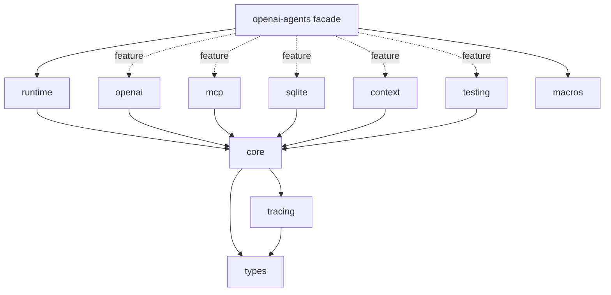

# 备选 workspace 方案

状态:待用户选择。推荐 B,A 是 B 的第一阶段。

## 方案 A:粗粒度(6 个 crate)

```
crates/
  openai-agents/          facade
  openai-agents-core/     types + tracing + core + runtime + context 全部留在这里
  openai-agents-openai/
  openai-agents-mcp/
  openai-agents-sqlite/
  openai-agents-macros/
```

- 做法:现有单体改名为 core,只把重依赖扩展抽出。
- 需要打破的环:C2、C3、C5、C6(以及 C10 的默认 provider 装配)。
- 优点:改动小、风险低;openai、mcp、sqlite 立即可按 crate 剥离。
- 缺点:core 仍约 15k 行;tracing、retry、compaction 不能单独剥离;内核内部无分层,AI 仍可能制造新环。

## 方案 B:中粒度(推荐,11 个 crate + conformance)

```
crates/
  openai-agents/               facade(examples、benches、跨 crate 测试)
  openai-agents-types/         L0
  openai-agents-tracing/       L1
  openai-agents-core/          L2
  openai-agents-runtime/       L3
  openai-agents-openai/        扩展
  openai-agents-mcp/           扩展(transport + 集成)
  openai-agents-sqlite/        扩展
  openai-agents-context/       扩展(ContextWindowTrimmer、ToolOutputTrimmer、CompactingSession)
  openai-agents-testing/       扩展(ScriptedModel、testing helpers)
  openai-agents-macros/
conformance/                   不发布:Python oracle、parity 场景与 golden
vendor/                        不变
```



### 现有文件 -> crate 映射(B)

| crate | 现有来源 | 备注 |
| --- | --- | --- |
| types | `usage.rs`、`error.rs`、`items.rs`、`stream_events.rs`、`model_settings.rs`、`strict_schema.rs`、`pyjson.rs`、`retry.rs` 的 settings/policy 类型与纯函数、下沉的 guardrail/tool_guardrails 载荷类型、`wire_events.rs` 的通用部分 | `retry` 的 executor(`call_with_retry`)依赖模型调用与睡眠,归属见 D7 |
| tracing | `tracing/mod.rs`(拆分) | 只依赖 types |
| core | `agent.rs`、`agent_output.rs`、`guardrail.rs`、`tool_guardrails.rs`、`tool.rs`、`lifecycle.rs`、`run_context.rs`、`handoffs/*`、`model/{mod,provider}.rs`、`memory.rs`(Session trait、InMemorySession、SessionSettings)、`memory/history.rs`、mcp 契约(`McpServer`、`McpConfig`、`mcp_function_tools`)、`CallModelData` 等模型输入类型 | `RunState` 数据结构是否下沉见 C4 / D11 |
| runtime | `run/*`、`run_state.rs`(执行相关)、`result.rs`、`build_agent_as_tool` | |
| openai | `model/openai/*`、`DefaultOpenAiApi` 与全局、`openai_retry_advice`、`wire_events.rs` 的 openai 专属部分 | |
| mcp | `mcp/{http,rpc,stdio,manager}.rs`、`McpClient`、`McpTool`、`ToolFilter`、`RequireApproval` 等(`mcp/mod.rs` 拆分后) | `manager.rs` 依赖 agent,故依赖 core |
| sqlite | `memory/sqlite.rs` | |
| context | `context.rs`、`memory/compaction.rs` | 依赖 core 与 tracing |
| testing | `model/scripted.rs`、`testing/mod.rs` | 见 D2 |
| macros | `macros/` | 增加 `crate = "..."` 覆盖,默认指向 facade |

- 优点:分层清晰,依赖方向由 Cargo 强制,AI 无法越层引用;剥离粒度够细;A 可作为 B 的中间态渐进达成。
- 缺点:需打破全部 11 类环;多 crate 的版本、发布、文档维护成本上升;`testing` 作为 core 的 dev-dependency 会造成 core 内单元测试出现双份类型(见 D2)。

## 方案 C:细粒度(约 16+ 个 crate)

在 B 基础上继续拆:types 拆为 usage / error / items / settings / retry / schema;runtime 拆为 loop / state;openai 拆为 chat-completions 与 responses;mcp 拆为 transport 与 integration;handoff-history 单独成 crate。

- 优点:剥离能力最强,增量编译最友好。
- 缺点:同层大量新接口,过度设计;发布顺序复杂;AI 要在十几个 crate 间判断落位,心智负担反而上升,与目标相悖。

## 对比

| 维度 | A | B | C |
| --- | --- | --- | --- |
| 需打破的环 | C2、C3、C5、C6、C10 | C1 至 C11 全部 | C1 至 C11 + 新增接口 |
| 剥离能力 | openai、mcp、sqlite | + tracing、context、testing、runtime 分层 | 最强 |
| AI 误用风险 | 内核仍可能生环 | 低(Cargo 强制) | 中(落位选项多) |
| 维护与发布成本 | 低 | 中 | 高 |
| 实施风险 | 低 | 中 | 高 |
| 建议 | B 的第一阶段 | 推荐 | 暂不推荐 |

## 关于"包体积"的说明

crate 拆分本身不会缩小最终二进制;体积收益来自"不依赖的扩展不被编译和链接"。重依赖(reqwest、rusqlite、async-openai)已经由现有 feature 门控,所以 A 相对现状的体积收益有限;B 的额外收益主要是编译时间、依赖边界与误用约束。落地后需用 P4 的体积对比验证,不做预设承诺。
